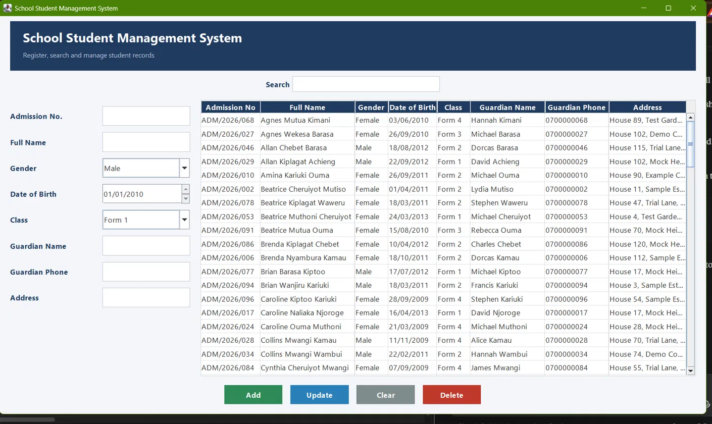

# School Student Management System

A desktop application for managing school student records, built with **Java Swing** and **MySQL**. Register students, search them instantly, and keep every change saved in a database.

## Features

- Add, update and delete student records
- Live search by name or admission number
- Input validation and duplicate admission-number protection
- Records stored permanently in MySQL through JDBC
- Clean navy and white interface with a banner, styled table and colour-coded buttons

## Tech Stack

- Java (Swing, built with NetBeans)
- MySQL 8
- JDBC (MySQL Connector/J)
- Maven

## Project Structure

- `Student.java`: the data model for one student
- `StudentDAO.java`: all SQL (add, update, delete, load) in one class
- `DBConnection.java`: database connection settings
- `SchoolStudentManagementSystem.java`: the user interface and button logic
- `schema.sql`: creates the database and table
- `sample_students.sql`: 100 fake students for testing

## Setup

1. Install a JDK and MySQL 8.
2. In MySQL Workbench, run `schema.sql`, then `sample_students.sql`.
3. Open `DBConnection.java` and replace `your_password_here` with your MySQL root password.
4. Open the project in NetBeans and run `SchoolStudentManagementSystem.java`.

## Screenshots

## Planned Improvements

- Classes management screen
- Login for staff
- Fee tracking
- Printable class lists

## Author

Adrian Silverstein Faruk, Computer Science student at Kenyatta University, Nairobi.
[LinkedIn](https://www.linkedin.com/in/adrian-faruk-ab905244a/)

All student data in this project is fictional.
